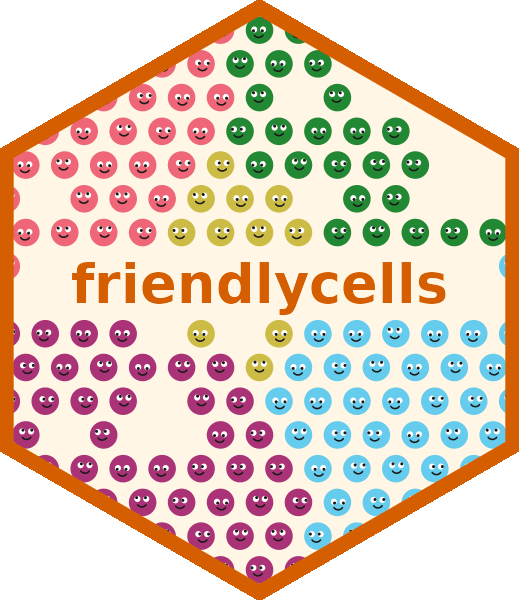

 

  
    
  friendlycells computes similarity between spatial transcriptomics samples
  based on which labels (e.g. cell types) border one another.

For installation and usage instructions, see friendlycells'
<a href="https://george-hall-ucl.github.io/friendlycells/">documentation</a>.

