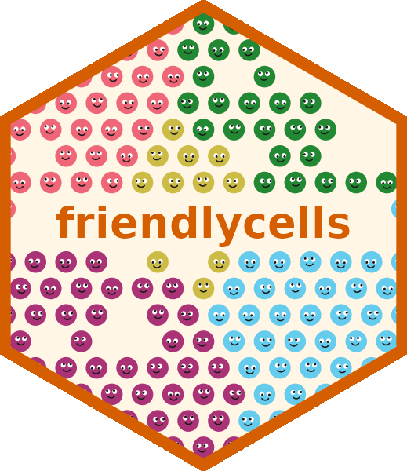

<p align="center">
  
</p>

`friendlycells` computes similarity between spatial transcriptomics samples
based on which labels (e.g. cell types) border one another.

It is available for R and Python and is compatible with Visium, Visium HD
(binned or segmented) and Xenium.

## Installation

::: {.panel-tabset group="language"}
## R

```r
remotes::install_github("george-hall-ucl/friendlycells", subdir = "R")
```

Requires `dbscan` and `deldir`.

## Python

```bash
pip install "git+https://github.com/george-hall-ucl/friendlycells#subdirectory=python"
```

Requires `pandas`, `numpy` and `scipy`.
:::

## Quick start

The main function is `spatial_similarity()`, which receives a [named
list]{.lang-r}[dict]{.lang-py} of [data frames]{.lang-r}[`pandas`
DataFrames]{.lang-py} (one for each sample you want to compare).

Each sample's [data frame]{.lang-r}[DataFrame]{.lang-py} needs three columns,
whose names you give to `spatial_similarity()`:

* `x`: horizontal coordinates of each spot/cell (any unit, but must be the same in each sample);
* `y`: vertical coordinates of each spot/cell, in the same unit as `x`;
* `labels`: metadata used to characterise spatial regions, e.g. cell types.

Select your language and technology to see how to make this
[list]{.lang-r}[dict]{.lang-py} and run `spatial_similarity()`.



::: {.snippet .lang-r .tech-visium}
```r
library(Seurat)
library(friendlycells)

# Assume you have two Visium samples, `healthy` and `diseased`, loaded using
# Seurat and you want to compare them using the annotated `cell_type` metadata.

samples <- list()
samples[["healthy"]] <- data.frame(x = GetTissueCoordinates(healthy)$x,
                                   y = GetTissueCoordinates(healthy)$y,
                                   label = healthy$cell_type)
samples[["diseased"]] <- data.frame(x = GetTissueCoordinates(diseased)$x,
                                    y = GetTissueCoordinates(diseased)$y,
                                    label = diseased$cell_type)
sim <- spatial_similarity(samples, x = "x", y = "y", labels = "label")
```
:::

::: {.snippet .lang-py .tech-visium}
```python
import pandas as pd

from friendlycells import spatial_similarity

# Assume you have two Visium samples, `healthy` and `diseased`, loaded as
# AnnData objects (e.g. using squidpy's `sq.read.visium()`), and you want to
# compare them using the annotated `cell_type` column of `.obs`.

samples = {}
samples["healthy"] = pd.DataFrame({
    "x": healthy.obsm["spatial"][:, 0],
    "y": healthy.obsm["spatial"][:, 1],
    "label": healthy.obs["cell_type"],
})
samples["diseased"] = pd.DataFrame({
    "x": diseased.obsm["spatial"][:, 0],
    "y": diseased.obsm["spatial"][:, 1],
    "label": diseased.obs["cell_type"],
})
sim = spatial_similarity(samples, x="x", y="y", labels="label")
```
:::

::: {.snippet .lang-r .tech-hd-bins}
```r
library(Seurat)
library(friendlycells)

# Assume you have two Visium HD samples, `healthy` and `diseased`, loaded using
# Seurat at a single bin size (e.g. `Load10X_Spatial(dir, bin.size = 8)`), and
# you want to compare them using the annotated `cell_type` metadata.

samples <- list()
samples[["healthy"]] <- data.frame(x = GetTissueCoordinates(healthy)$x,
                                   y = GetTissueCoordinates(healthy)$y,
                                   label = healthy$cell_type)
samples[["diseased"]] <- data.frame(x = GetTissueCoordinates(diseased)$x,
                                    y = GetTissueCoordinates(diseased)$y,
                                    label = diseased$cell_type)
sim <- spatial_similarity(samples, x = "x", y = "y", labels = "label")
```
:::

::: {.snippet .lang-py .tech-hd-bins}
```python
import pandas as pd

from friendlycells import spatial_similarity

# Assume you have two Visium HD samples, `healthy` and `diseased`, loaded as
# AnnData tables of a single bin size (e.g. `sdata.tables["square_008um"]`,
# using spatialdata-io's `visium_hd()`), and you want to compare them using
# the annotated `cell_type` column of `.obs`.

samples = {}
samples["healthy"] = pd.DataFrame({
    "x": healthy.obsm["spatial"][:, 0],
    "y": healthy.obsm["spatial"][:, 1],
    "label": healthy.obs["cell_type"],
})
samples["diseased"] = pd.DataFrame({
    "x": diseased.obsm["spatial"][:, 0],
    "y": diseased.obsm["spatial"][:, 1],
    "label": diseased.obs["cell_type"],
})
sim = spatial_similarity(samples, x="x", y="y", labels="label")
```
:::

::: {.snippet .lang-r .tech-hd-cells}
```r
library(Seurat)
library(friendlycells)

# Assume you have two Visium HD samples, `healthy` and `diseased`, loaded using
# Seurat with segmented cells (`Load10X_Spatial(dir, bin.size = "polygons")`),
# and you want to compare them using the annotated `cell_type` metadata.

samples <- list()
samples[["healthy"]] <- data.frame(x = GetTissueCoordinates(healthy)$x,
                                   y = GetTissueCoordinates(healthy)$y,
                                   label = healthy$cell_type)
samples[["diseased"]] <- data.frame(x = GetTissueCoordinates(diseased)$x,
                                    y = GetTissueCoordinates(diseased)$y,
                                    label = diseased$cell_type)
sim <- spatial_similarity(samples, x = "x", y = "y", labels = "label")
```
:::

::: {.snippet .lang-py .tech-hd-cells}
```python
import pandas as pd

from friendlycells import spatial_similarity

# Assume you have two Visium HD samples, `healthy` and `diseased`, loaded as
# SpatialData objects using spatialdata-io's `visium_hd()`, and you want to
# compare them using the annotated `cell_type` column of the cell segmentation
# table. Each cell's position is the centroid of its outline.

samples = {}
table = healthy.tables["cell_segmentations"]
cells = healthy.shapes[table.obs["region"].iloc[0]].centroid.loc[table.obs_names]
samples["healthy"] = pd.DataFrame({
    "x": cells.x,
    "y": cells.y,
    "label": table.obs["cell_type"],
})
table = diseased.tables["cell_segmentations"]
cells = diseased.shapes[table.obs["region"].iloc[0]].centroid.loc[table.obs_names]
samples["diseased"] = pd.DataFrame({
    "x": cells.x,
    "y": cells.y,
    "label": table.obs["cell_type"],
})
sim = spatial_similarity(samples, x="x", y="y", labels="label")
```
:::

::: {.snippet .lang-r .tech-xenium}
```r
library(Seurat)
library(friendlycells)

# Assume you have two Xenium samples, `healthy` and `diseased`, loaded using
# Seurat (`LoadXenium()`), and you want to compare them using the annotated
# `cell_type` metadata.

samples <- list()
samples[["healthy"]] <- data.frame(x = GetTissueCoordinates(healthy)$x,
                                   y = GetTissueCoordinates(healthy)$y,
                                   label = healthy$cell_type)
samples[["diseased"]] <- data.frame(x = GetTissueCoordinates(diseased)$x,
                                    y = GetTissueCoordinates(diseased)$y,
                                    label = diseased$cell_type)
sim <- spatial_similarity(samples, x = "x", y = "y", labels = "label")
```
:::

::: {.snippet .lang-py .tech-xenium}
```python
import pandas as pd

from friendlycells import spatial_similarity

# Assume you have two Xenium samples, `healthy` and `diseased`, loaded as
# AnnData tables (e.g. `sdata.tables["table"]`, using spatialdata-io's
# `xenium()`), and you want to compare them using the annotated `cell_type`
# column of `.obs`.

samples = {}
samples["healthy"] = pd.DataFrame({
    "x": healthy.obsm["spatial"][:, 0],
    "y": healthy.obsm["spatial"][:, 1],
    "label": healthy.obs["cell_type"],
})
samples["diseased"] = pd.DataFrame({
    "x": diseased.obsm["spatial"][:, 0],
    "y": diseased.obsm["spatial"][:, 1],
    "label": diseased.obs["cell_type"],
})
sim = spatial_similarity(samples, x="x", y="y", labels="label")
```
:::

`spatial_similarity()` returns a sample × sample matrix of similarity scores,
where a score of 1 means that two samples are identical and 0 means that they
are the least similar pair. See the [vignette](vignette.qmd) for a worked
example, and [Reference](reference.qmd) for full documentation of all options.

As inter-sample similarities are calculated in terms of neighboring `label`s,
different definitions of "neighboring" will likely produce different results.
By default, `friendlycells` tries to use a sensible definition for each
technology. You can use `plot_neighborhoods()` to visualize the impact of your
neighborhood settings in `spatial_similarity()`. See the [neighborhood
documentation](neighborhoods.qmd) for more information about different
definitions.

## Citation

The original algorithm and implementation of `friendlycells` were first
published in:

- Durkin _et al_. "Functional integration of an autologous engineered esophagus
  in a large-animal model." _Nature Biotechnology_ (2026).
- Budinger _et al_. "An in vivo and in vitro spatiotemporal profile of human
  midbrain development." _Nature Communications_ (2026).
